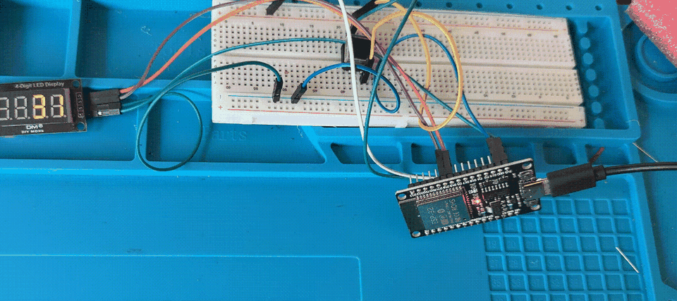
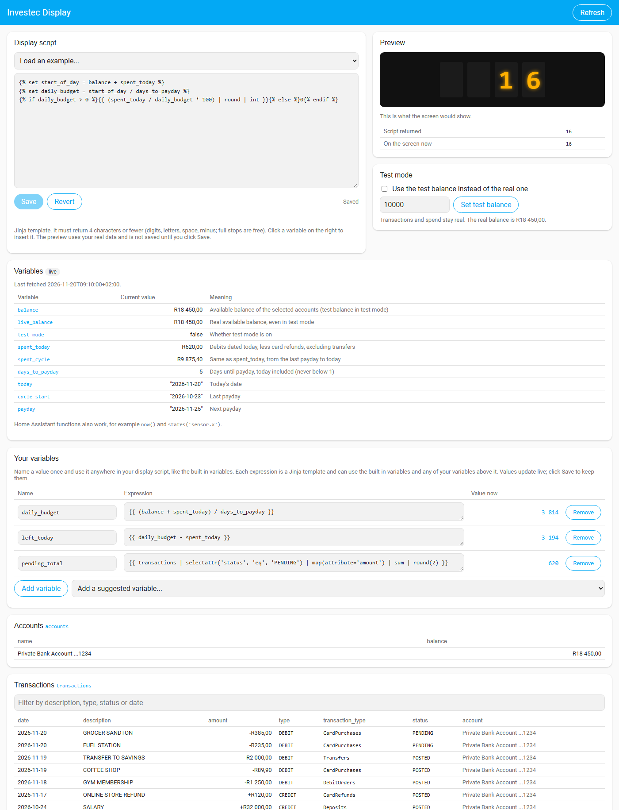

# Investec IoT Display

A small 4-digit screen on your desk that shows a number or word worked out from your Investec bank account. You decide what that is.

Home Assistant reads your balance and transactions from Investec every 10 minutes. You write a short formula, and its answer appears on the screen. It could be:

- how much of today's budget you have spent
- money left to spend today
- days until payday
- a word like GOOD or OVER
- how many purchases you made today
- how much you spent at one shop
- anything else you can work out from your balance and transactions

You edit the formula on a page in Home Assistant. Pick one of the ready-made examples or write your own, and the page shows exactly what the screen will display before you save it.

Built for the Investec Programmable Banking "Make Money Move" bounty.

##### Secure Mirror:
https://git.wethegordons.co.za/seangordon/investec_IoT

## Demo

#### Built on a prototype board

## Homeassistant

## Write your own, or start from an example

The page has a formula editor with a live preview, ten ready-made examples, a list of everything you can use (balance, today's spend, days to payday, your transactions and more), and a place to save your own named values. A test mode lets you try your formula against a pretend balance.

The formula uses Home Assistant's template language. The only rule is that the answer must fit on the screen: 4 characters or fewer. The [guide](docs/GUIDE.md) explains how to write one, in plain steps.

## Example: the daily budget

The screen starts with this example. It works out how much you can spend each day until payday and shows how much of today's budget you have used.

| The screen shows | It means |
| --- | --- |
| Under 100 | You are on track for today |
| 100 | You have spent exactly today's budget |
| Over 100 | You have overspent today |

| Step | Example |
| --- | --- |
| Money in your account right now | R8 600 |
| Plus what you have already spent today | R400 |
| Money you had this morning | R9 000 |
| Divided by the days left until payday (including today) | 6 |
| Today's budget | R1 500 |
| What you have spent today, as a share of that | 27 |

The number goes up as you spend during the day and starts again the next morning. If you overspend today, tomorrow's budget is a little smaller, and every day you stay under leaves more money for payday. Card purchases count as soon as Investec shows them, even before they go through.

## How it fits together

1. **Your Investec account.** Investec lets you read your own balance and transactions through its Programmable Banking feature.
2. **Home Assistant.** It checks your account every 10 minutes and runs your formula.
3. **The screen.** A small ESP32 board with a 4-digit LED display. It shows whatever Home Assistant sends it. A button on it turns the screen on and off.

Your bank login details stay in Home Assistant. They are never stored in this project's files.

## What you need

- An Investec account with Programmable Banking switched on
- Home Assistant running at home
- An ESP32 board, a TM1637 4-digit display, a push button and a few jumper wires (about R200 of parts)

## Set it up

The [step-by-step guide](docs/GUIDE.md) takes you through everything: wiring the screen, putting it on your Wi-Fi, connecting Investec and choosing what to show.

## Licence

MIT. See `LICENSE`.
