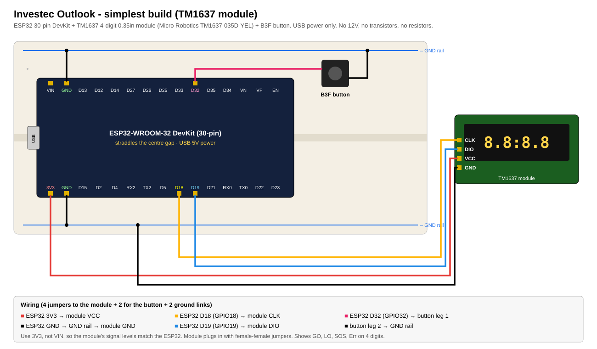
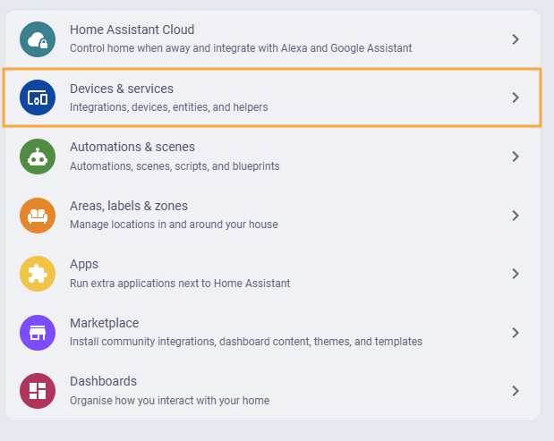
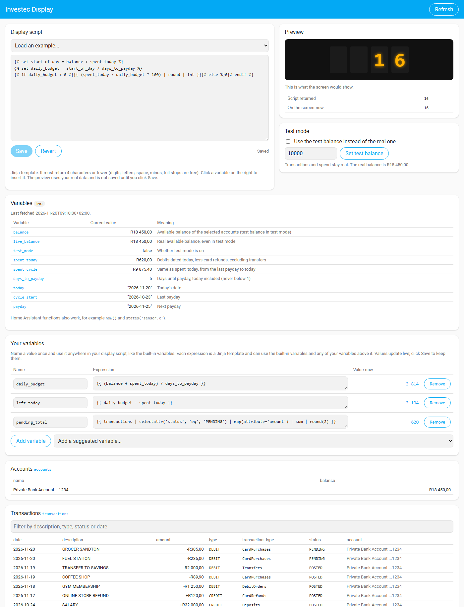
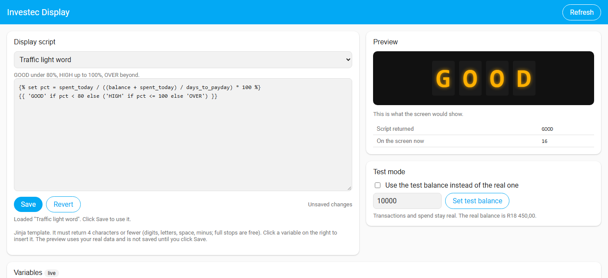
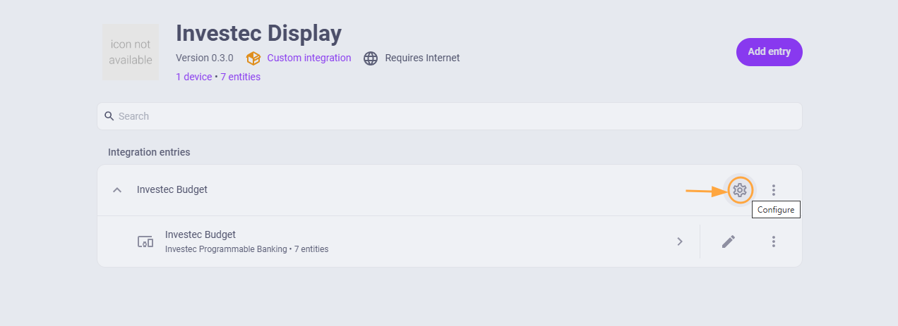
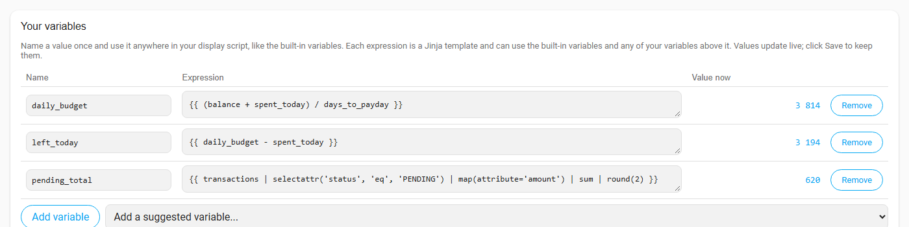

# Investec Display: step-by-step guide

This guide takes you from a bag of parts to a working screen on your desk. Do the parts in order. Each step says exactly what to click or type.

## Contents

1. [What you need](#1-what-you-need)
2. [Wire up the screen](#2-wire-up-the-screen)
3. [Put the screen on your Wi-Fi](#3-put-the-screen-on-your-wi-fi)
4. [Get your Investec keys](#4-get-your-investec-keys)
5. [Add Investec to Home Assistant](#5-add-investec-to-home-assistant)
6. [Send the number to the screen](#6-send-the-number-to-the-screen)
7. [Choose what the screen shows](#7-choose-what-the-screen-shows)
8. [Make your own](#8-make-your-own)
9. [If something is not working](#9-if-something-is-not-working)

## 1. What you need

**Parts**

- ESP32 dev board (the classic 30-pin ESP32-WROOM)
- TM1637 4-digit LED display module
- A push button
- 6 jumper wires (female-to-female fits the display's pins)
- A USB cable that carries data, not only power

**Accounts and software**

- An Investec account with Programmable Banking switched on (Investec Online > Programmable Banking)
- Home Assistant running at home, with the **ESPHome Device Builder** app installed (Settings > Apps > App store, search for ESPHome)
- A way to copy files onto Home Assistant. The easiest is the **Samba share** app (Settings > Apps > App store, search for Samba)
- Chrome or Edge on your computer, for the first install

## 2. Wire up the screen

Unplug the USB cable first. Then connect these wires:

| ESP32 pin | Connects to |
| --- | --- |
| 3V3 | Display VCC |
| GND | Display GND |
| D18 (GPIO18) | Display CLK |
| D19 (GPIO19) | Display DIO |
| D32 (GPIO32) | One leg of the button |
| GND (the other GND pin) | The other leg of the button |

Use **3V3**, not VIN, for the display. The pin names are printed on the board.



## 3. Put the screen on your Wi-Fi

You only need the USB cable for the very first install. After that, updates go over Wi-Fi.

**Create the device**

1. In Home Assistant, open **ESPHome Device Builder** from the sidebar.
2. Click **+ New device**, name it `investec-outlook` and choose **ESP32**.
3. Device Builder shows an **encryption key**. Copy it into a note; you need it in a moment.
4. Click **Edit** on the new `investec-outlook` card. Delete everything in the editor.
5. Open [`ESP32/esphome/investec-outlook.yaml`](../ESP32/esphome/investec-outlook.yaml) from this project, copy all of it and paste it into the editor. Click **Save**.

**Add your passwords**

6. Click **Secrets** (top right of Device Builder) and add these five lines, with your own values:

   ```yaml
   wifi_ssid: "your Wi-Fi name"
   wifi_password: "your Wi-Fi password"
   outlook_api_key: "the encryption key you copied in step 3"
   outlook_ota_password: "any password you choose"
   outlook_ap_password: "any password you choose"
   ```

   Use a 2.4 GHz Wi-Fi network. The ESP32 cannot join 5 GHz.

7. Click **Save**.

**Install it**

8. On the `investec-outlook` card, click **Install**, then **Manual download**, then **Factory format**. A `.bin` file downloads to your computer.
9. Plug the ESP32 into your computer with the USB cable.
10. In Chrome or Edge, go to **web.esphome.io**, click **Connect**, pick the USB port and click **Install**. Choose the `.bin` file.
    If it gets stuck on "Connecting", hold the **BOOT** button on the ESP32 until it starts writing.
11. When it finishes, unplug it and plug it into any USB charger.

**Add it to Home Assistant**

12. Within a minute Home Assistant shows **New device discovered: Investec Outlook**. Click **Configure** and paste the encryption key if asked.
13. The screen shows `----`. That means it is working and waiting for a number.

Press the button once: the screen shows `OFF`. Press it again and it comes back on.

## 4. Get your Investec keys

1. Log in to **Investec Online**.
2. Go to **Programmable Banking**, then **Manage API keys**.
3. Click **Create key** and give it read access to **accounts**, **balances** and **transactions**.
4. Keep the page open. You need three things from it: the **Client ID**, the **Client secret** and the **API key**.

You type these straight into Home Assistant in the next part. Do not save them in a file or send them to anyone.

## 5. Add Investec to Home Assistant

**Copy the files**

1. Start the **Samba share** app in Home Assistant (set a username and password in its Configuration tab first).
2. On your computer, open File Explorer and type `\\homeassistant.local\config` in the address bar. Log in with the Samba username and password.
3. If there is no folder called `custom_components`, create one.
4. Copy the folder `Home Assistant/custom_components/investec_budget` from this project into `custom_components`.
   You should end up with `config\custom_components\investec_budget\manifest.json`.

**Set the time zone and restart**

5. In Home Assistant, go to **Settings > System > General** and set the time zone to **Africa/Johannesburg**. Click **Save**.
6. Go to **Settings > System**, click the power icon (top right) and choose **Restart Home Assistant**. Wait for it to come back.

**Add the integration**

7. Go to **Settings > Devices & services**.

   

8. Click **+ Add integration** and search for **Investec Display**. (If it is not there, refresh the page with Ctrl+F5.)
9. Paste in your **Client ID**, **Client secret** and **API key** and click **Submit**.
10. Choose your settings and click **Submit**:
    - **Accounts:** tick only the account you spend from. Do not tick a credit card; its credit limit would make your budget far too big.
    - **Payday:** the day of the month you get paid, for example 25. Use 1 if you just want to budget by calendar month.
    - **Move weekend paydays to the Friday before:** leave this ticked if your salary arrives early when payday falls on a weekend.
    - **Display script:** leave it as it is for now.

A new **Investec Display** item now appears in the Home Assistant sidebar.

## 6. Send the number to the screen

1. Go to **Settings > Automations & scenes** and click **+ Create automation**, then **Create new automation**.
2. Click the three dots (top right) and choose **Edit in YAML**.
3. Delete what is there. Open [`automation_budget_to_display.yaml`](../Home%20Assistant/automation_budget_to_display.yaml) from this project, copy all of it and paste it in.
4. Click **Save**.

Within a minute the screen shows today's number. It updates every few minutes after that.

## 7. Choose what the screen shows

Open **Investec Display** in the Home Assistant sidebar.



*The screenshots in this guide use made-up sample data.*

**Pick a ready-made option**

1. Click **Load an example...** and choose one, for example **Days to payday** or **Traffic light word**.
2. Look at the **Preview**. It shows exactly what the screen will show, using your real account.
3. Click **Save**. The screen changes within a few seconds.

   

Changed your mind? Click **Revert** before saving, or load the **Daily budget used** example to go back to the original.

**Test with a pretend balance**

In the **Test mode** box, tick **Use the test balance**, type an amount and click **Set test balance**. The preview and the screen now use that amount instead of your real balance, so you can see how today's spending would look with more or less money. Untick it to go back to your real numbers.

**Other things you can do**

- Change settings like your accounts or payday: **Settings > Devices & services > Investec Display**, then the cog (**Configure**).

  

- Change the screen brightness: **Settings > Devices & services > ESPHome > Investec Outlook**, then **Display brightness**.
- Turn the screen off: press the button on the board, or switch off **Screen** on the Investec Outlook device.

## 8. Make your own

You can write your own instruction for what the screen shows. It is a short formula written in Home Assistant's template language. The Investec Display page shows the result as you type, so you can experiment safely; nothing changes until you click **Save**.

**The one rule:** the result must be 4 characters or fewer, using digits, letters, spaces or a minus sign. A full stop does not use up a space, so `12.34` fits. A few letters cannot be drawn on this kind of display and would show as `8`: K, M, X, q, w and z. If the result does not fit, the preview shows `Err` and tells you why.

**The basics**

- Anything inside `{{ }}` is worked out and shown. `{{ days_to_payday }}` shows `5`.
- `| round | int` turns a number like 26.7 into a whole number, 27.
- `` saves a result so you can use it later in the same formula.

**What you can use**

Click any name in the Variables table on the page to drop it into your formula.

| Name | What it is |
| --- | --- |
| `balance` | Money in your account now (or your test balance in test mode) |
| `live_balance` | Money in your account now, even in test mode |
| `spent_today` | What you have spent today |
| `spent_cycle` | What you have spent since payday |
| `days_to_payday` | Days left until payday, including today |
| `today` | Today's date, like `2026-11-20` |
| `cycle_start` | Your last payday |
| `payday` | Your next payday |
| `test_mode` | Whether test mode is on |
| `accounts` | Your accounts and their balances |
| `transactions` | Your transactions since payday: date, amount, description and so on |

The **Transactions** table on the page shows exactly how your purchases are described, which helps if you want to count spending at one shop.

**Some formulas to copy**

Money left to spend today (shows OVER once you pass the budget):

```jinja

OVER{{ [left | round | int, 9999] | min }}
```

A word instead of a number:

```jinja

{{ 'GOOD' if pct < 80 else ('HIGH' if pct <= 100 else 'OVER') }}
```

Number of purchases today:

```jinja
{{ transactions | selectattr('date', 'eq', today) | selectattr('type', 'eq', 'DEBIT') | list | count }}
```

Spent at one shop today (change WOOLWORTHS to part of the shop's name as it appears on your statement):

```jinja
{{ transactions | selectattr('date', 'eq', today) | selectattr('description', 'search', 'WOOLWORTHS') | map(attribute='amount') | sum | round | int }}
```

More are in the **Load an example...** list on the page.

**Save your own names**

If you use the same sum often, give it a name in the **Your variables** box on the page.

1. Click **Add variable**, or pick one from **Add a suggested variable...** (there are 12, such as `daily_budget`, `left_today` and `pending_total`).
2. Give it a name, using lower case letters, numbers and `_` (for example `daily_budget`).
3. Type the formula, for example `{{ (balance + spent_today) / days_to_payday }}`. Its current value appears on the right.
4. Use it in your display formula like any other name, for example `{{ daily_budget | round | int }}`.
5. Click **Save**.

A variable can use the ones listed above it. If one shows "error", hover over it to see why.



## 9. If something is not working

| What you see | What to do |
| --- | --- |
| The screen shows `----` | The screen is on but Home Assistant has not sent a number yet. Check part 6, and that the automation is switched on. |
| The screen shows `OFF` | It has been turned off. Press the button. |
| The screen shows `Err` | Your formula gives something the screen cannot show. Open the Investec Display page; the preview says what is wrong. |
| The screen shows `0` all day | Card purchases can take a few minutes to appear at Investec, and Home Assistant checks every 10 minutes. If it stays at 0, check that you ticked the right account in part 5. |
| The number seems far too low | A credit card might be ticked. Its credit limit counts as money to spend. Untick it under **Configure**. |
| Investec Display is not in the sidebar | Refresh your browser. The page is only shown to Home Assistant admin users. |
| The page says Investec Display is not loaded | Investec can be slow to answer after a restart. Wait a minute and click **Refresh**. |
| Investec Display is not in **Add integration** | Check the folder is at `config\custom_components\investec_budget`, restart Home Assistant and refresh the page. |
| Investec rejected the keys | Check all three keys. If you are using Investec's test (sandbox) keys, tick **Use sandbox**. |
| The ESP32 will not install | Try another USB cable (many only carry power) and hold the **BOOT** button while it connects. |
